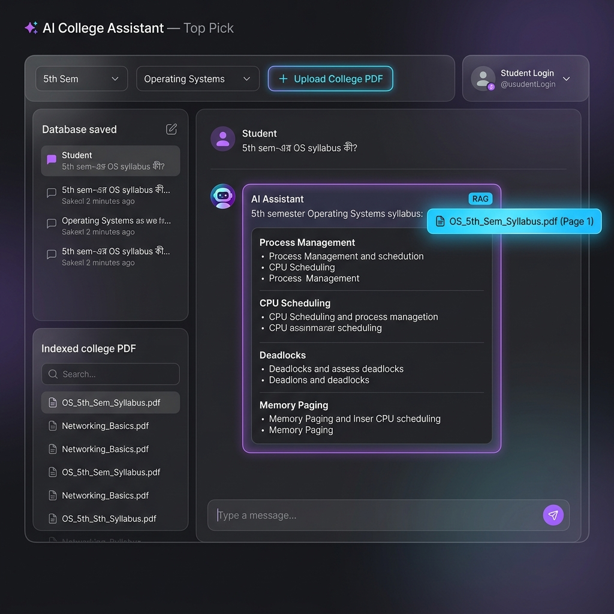

# 🤖 AI College Assistant — Top Pick RAG System

An intelligent full-stack AI web application for university students to query course syllabi, lecture notes, exam questions, and study materials in **Bengali**, **English**, or **Banglish**. Powered by Retrieval-Augmented Generation (RAG) and Google Gemini AI API.



## 🌟 Key Features

- **💬 Bengali & English Natural AI Chat**: Ask questions like *"5th sem-এর OS syllabus কী?"* or *"Explain Deadlock Banker's Algorithm"*.
- **📄 College PDF Notes Ingestion**: Upload college syllabus PDFs, lecture notes, or question banks with Semester & Subject tags.
- **⚡ RAG (Retrieval-Augmented Generation)**: Extracts text, chunks documents by page/section, and grounds AI answers with exact source citations (`Source: OS_5th_Sem_Syllabus.pdf - Page 1`).
- **🔐 Student Auth**: Student Login & Profile management using JWT authentication.
- **📜 MySQL Chat History**: Persistent chat sessions saved per student in a database.
- **🎨 Glassmorphism Design System**: Modern dark-themed UI with smooth micro-animations.

---

## 🛠️ Tech Stack

- **Frontend**: React (Vite) + Lucide Icons + Glassmorphism CSS + PDF.js
- **Backend**: Java Spring Boot 3.x + Spring Data JPA + Apache PDFBox
- **Database**: MySQL (with H2 embedded fallback for instant testing)
- **AI & RAG Engine**: Google Gemini API + Vector Similarity TF-IDF Retrieval

---

## 🚀 Quick Start Guide

### 1. Clone Repository
```bash
git clone https://github.com/YOUR_USERNAME/ai-college-assistant.git
cd ai-college-assistant
```

### 2. Start Preview Web Application (Instant)
```bash
python3 -m http.server 3000
```
Open [http://localhost:3000](http://localhost:3000) in your browser!

### 3. Run Backend (Spring Boot 8080)
```bash
cd backend
mvn spring-boot:run
```

### 4. Run Frontend (React Vite 3000)
```bash
cd frontend
npm install
npm run dev
```

---

## 📂 Project Structure

```
ai-college-assistant/
├── backend/                  # Java Spring Boot 3.x Backend REST API
│   ├── src/main/java/        # Controllers, Services, Entities, Repositories
│   └── src/main/resources/   # application.properties & schema.sql
├── frontend/                 # React Vite Single Page App
│   ├── src/components/       # Navbar, Sidebar, ChatWindow, PdfUploadModal, AuthModal
│   └── src/services/         # API Service client
├── index.html                # Standalone preview web application
├── OS_5th_Sem_Syllabus.pdf   # Sample college PDF document
└── README.md
```

---

## 📜 License
MIT License. Free for educational and campus use!
